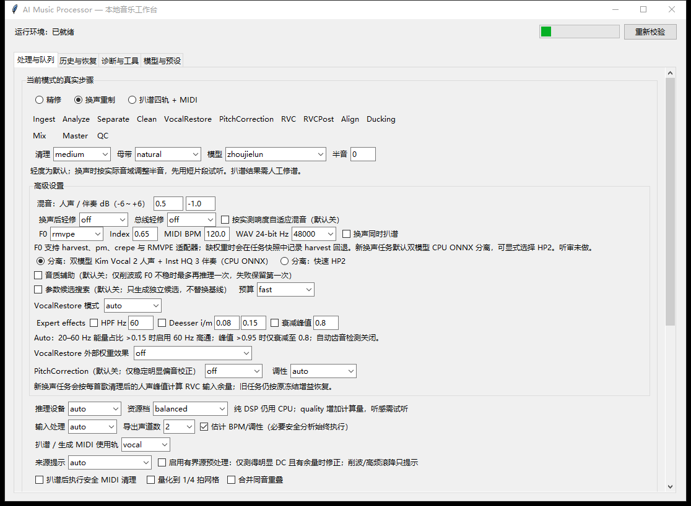
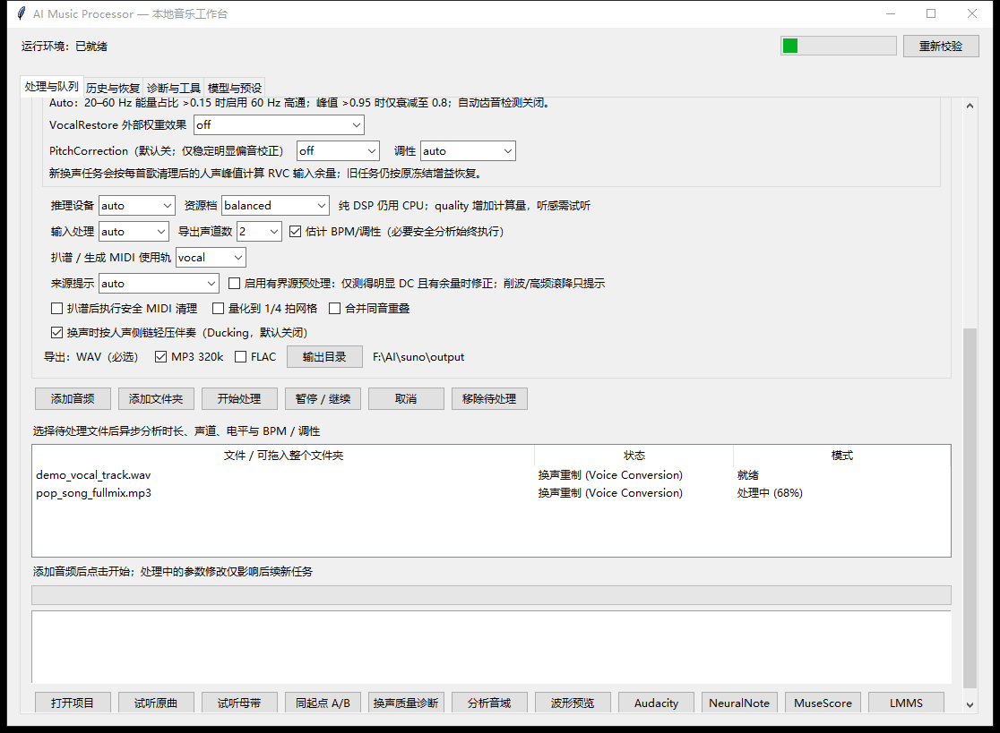
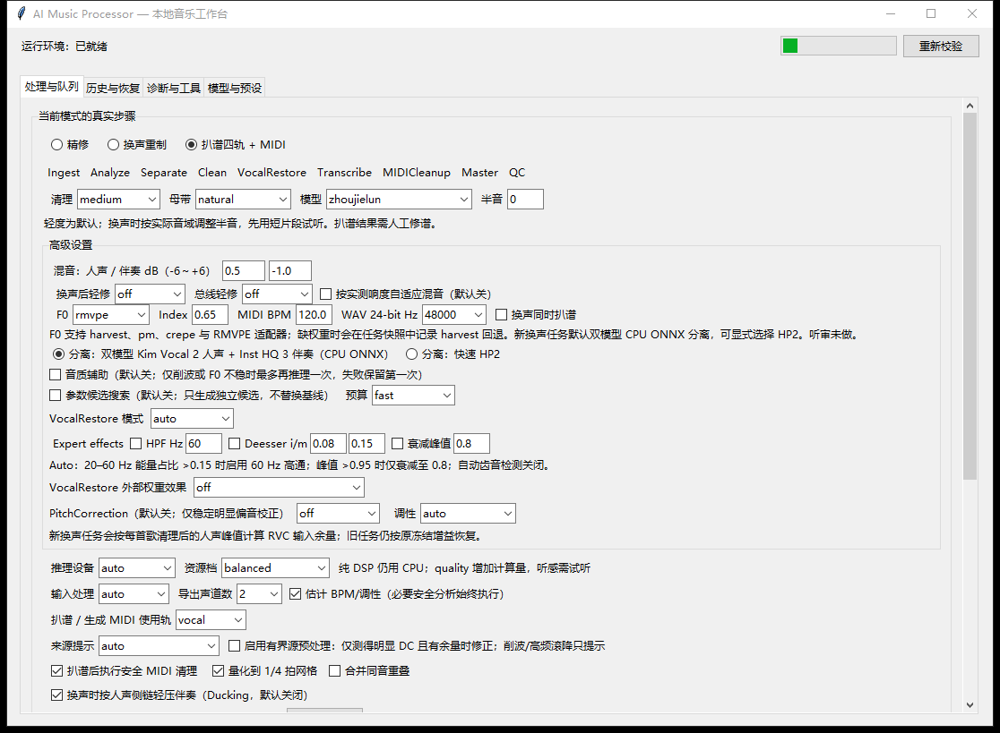
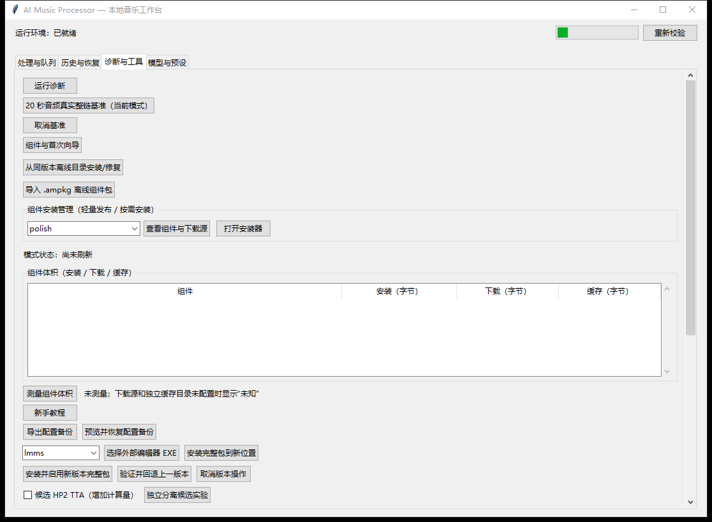

# AI Music Processor (本地 AI 音乐一体化工作台)

<div align="center">

[](LICENSE)
[](https://github.com/rowanjove/AI-Music-Processor)
[](https://www.python.org/)
[](https://github.com/rowanjove/AI-Music-Processor/releases)

**面向创作者与音频工程师的专业级本地离线 AI 音乐处理工作台**  
**集成音频精修（Polish）· 人声换声重制（Voice Conversion）· 分轨扒谱（Transcribe）**

[快速上手](#-快速上手) • [核心功能](#-核心功能与流水线) • [轻量分发架构](#-轻量分发与按需安装) • [命令行界面](#-cli-命令行使用) • [许可证](#-开源许可证与致谢)

</div>

---

## 📸 界面预览

### 主工作台 (Main Workbench)


### 换声重制与高级混音配置 (Voice Conversion & Advanced Audio Settings)


### 四轨分轨与智能扒谱模式 (4-Stem Separation & MIDI Transcription)


### 模型库与预设管理 (Models & Presets)


---

## 🌟 核心特性

- 🔒 **100% 本地运行与数据隐私**：所有音频计算、神经网络推理及项目缓存均在本地完成，无需上传云端，保障创作版权与数据绝对安全。
- 🎛️ **三大核心流水线一体化**：
  - **音频精修 (Audio Polish)**：音频解包 → 缺陷修复 → 均衡音色塑造 → 多频段动态压缩 → 立体声声场拓宽 → 工业级自然母带（支持 True Peak 保护与 LUFS 响度对齐）。
  - **人声换声重制 (Voice Conversion)**：双模型分离（Kim Vocal 2 / Inst HQ 3）→ 人声降噪去杂 → RMVPE/Harvest 高精度音高提取 → RVC 神经声码换声 → 微秒级相位时间对齐 → 自动侧链避让（Ducking）与混音母带。
  - **四轨分轨与扒谱 (Transcribe)**：HTDemucs 四轨分离（人声/鼓/贝斯/其他）→ Basic Pitch 深度学习智能扒谱 → MIDI 自动量化与清理 → DAW 项目协同。
- 📊 **端到端专业质检 (Audio QC)**：自动检测全流音频时长、静音段、DC 偏移、NaN/Inf 异常、削波失真、声道 RMS、相关性、LUFS 及换声残余同步误差，拒绝生成伪影。
- ⚡ **高性能自适应硬件调度**：原生支持 NVIDIA CUDA GPU 加速与 FP32/FP16 推理；遇到显存吃紧自动平滑降窗与 CPU 容灾回退，防止任务中断崩溃。
- 🔄 **断点续做与 Stage 缓存**：支持项目级粒度恢复，昂贵的分离与推理产物具备 SHA-256 智能缓存指纹，参数未变秒级复用，极大提升批量生产力。
- 🔌 **全生态 DAW 与外部编辑器联动**：支持一键拉起或导入 Audacity、LMMS、MuseScore、NeuralNote，衔接专业后期制作流。

---

## 🚀 快速上手

### 系统环境要求
- **操作系统**：Windows 10 / 11 64-bit
- **处理器**：Intel Core i5 / AMD Ryzen 5 及以上
- **显卡推荐**：NVIDIA GeForce GTX 1060 (6GB) 及以上（支持 CUDA），亦完全支持纯 CPU 模式运行
- **内存**：8 GB RAM 以上（推荐 16 GB 及以上）

### 安装与启动（轻量源码引导模式）

本项目采用**轻量分发设计**。Release 发布包与仓库源码不塞入动辄数 GB 的重型依赖和模型，保证仓库轻便高效。你可以通过官方内置的 PowerShell 引导脚本按需完成初始化：

#### 1. 克隆仓库或下载 Release 轻量包
```powershell
git clone https://github.com/rowanjove/AI-Music-Processor.git
cd AI-Music-Processor
```

#### 2. 查看或按需安装核心组件
在工作区根目录打开 PowerShell：

- **查看支持的组件清单与计划**：
  ```powershell
  powershell -ExecutionPolicy Bypass -File scripts/install_components.ps1 -List
  ```

- **一键安装基础环境与音频精修引擎**：
  *(若系统未安装特定版本 Python 3.9，添加 `-InstallPython` 允许引导器自动获取官方独立运行时)*
  ```powershell
  powershell -ExecutionPolicy Bypass -File scripts/install_components.ps1 -InstallPython -Components polish
  ```

- **按需安装外部编辑器（如 Audacity / LMMS / MuseScore）**：
  ```powershell
  powershell -ExecutionPolicy Bypass -File scripts/install_components.ps1 -Components tool.audacity
  ```

#### 3. 启动应用
在根目录下双击 `AI-Music-Processor.exe`（原生 C# 启动引导器）或运行批处理脚本：
```cmd
启动AI音乐一体化处理器.bat
```
工作台将即刻启动并在前台展现；后台自动执行运行环境验证与模型准备。

---

## 🛠️ 核心功能与流水线

### 1. 音频精修流水线 (Polish Pipeline)
针对伴奏、翻唱干声或播客录音，执行标准工业级母带修正：
```
输入音频 ➔ 解码校验 ➔ 频谱缺陷修复 ➔ EQ音色平衡 ➔ 动态多段压缩 ➔ 立体声拓宽 ➔ 响度测量 ➔ 24-bit True-Peak 母带 ➔ 质检报告
```
- 输出规格：24-bit WAV (44.1kHz / 48kHz)、高质量 MP3 (320kbps)、无损 FLAC。
- 防过载保护：True Peak 双重衰减防护，杜绝任何数码破音。

### 2. 人声换声流水线 (Voice Conversion Pipeline)
```
整首曲目 ➔ 人声/伴奏高精度分离 ➔ 人声除噪与杂音清洗 ➔ 音高轮廓提取 (Harvest/RMVPE) ➔ RVC 声学特征替换 ➔ 时间相位微秒级对齐 ➔ 智能避让(Ducking) ➔ 混音母带
```
- 自定义声音模型：支持将 RVC 训练好的权重放置于 `models/rvc/{模型名称}/model.pth` 与检索索引 `.index`，系统自动加载与识别。

### 3. 分轨与智能扒谱 (Transcribe Pipeline)
```
整曲音频 ➔ HTDemucs 4-Stem 分离 (人声/鼓/贝斯/其他) ➔ Basic Pitch 深度神经网络 ➔ 离散音符检测与时值量化 ➔ 标准 MIDI 导出 ➔ 伴奏工程联动
```
- 导出的标准 MIDI 文件可直接送入 MuseScore 编曲排版或通过 LMMS 加载 SoundFont 进行重编曲。

---

## 💻 CLI 命令行使用

除了 GUI 桌面交互，`process_music.py` 支持完整的无头批处理与自动化集成：

```powershell
# 1. 换声重制模式 (指定模型、半音升降、生成伴奏与多格式母带)
python process_music.py "song/demo.mp3" --mode voice_conversion --model sunyanzi --pitch 7 --midi --formats wav,mp3,flac

# 2. 纯音频精修模式
python process_music.py "song/guitar.wav" --mode polish --formats wav,flac

# 3. 恢复中断的任务
python process_music.py --resume <job_id>

# 4. 执行系统诊断与基准测试
python process_music.py --diagnose

# 5. 缓存管理与清理预览
python process_music.py --cache-preview --cache-quota-gb 20 --cache-ttl-days 30
```

---

## 📁 项目目录结构

```
AI-Music-Processor/
├── AI-Music-Processor.exe       # 原生快速启动引导器
├── AI_Music_Processor.pyw       # Tkinter 桌面主工作台核心逻辑
├── process_music.py             # CLI 命令行处理入口
├── 启动AI音乐一体化处理器.bat   # Windows 便捷启动脚本
├── app/                         # 桌面引导层与 C# 源码
├── core/                        # 音频核心引擎、DSP、分离、换声与质检逻辑
│   ├── analyzer.py              # 音频特征分析与音域检测
│   ├── pipeline.py              # 核心任务调度与状态流水线
│   ├── rvc_engine.py            # RVC 模型推理桥接
│   ├── separator.py             # UVR / Demucs 伴奏人声分离引擎
│   ├── transcriber.py          # Basic Pitch 智能 MIDI 扒谱
│   └── qc.py                    # 综合音频质检与异常分析
├── packaging/                   # 下载源策略与配置文件
├── runtime-manifest/            # 运行时组件与清单配置
├── scripts/                     # 构建、安装与验证自动化脚本
│   ├── build_lightweight.py     # 轻量源码包构建器
│   └── install_components.ps1   # PowerShell 组件按需安装器
├── tests/                       # 全量自动化测试套件 (120+ 测试用例)
├── docs/                        # 详细架构与技术设计文档
├── LICENSE                      # Apache-2.0 许可证
└── THIRD_PARTY_LICENSES.md      # 第三方依赖与开源协议清单
```

---

## 📦 轻量分发与按需安装

为了遵循开源分发最佳实践并保护开源仓库体积，本项目实行**源码/引导层与模型/重量资产解耦**机制：

- 源码仓库与 GitHub Release **仅发布轻量源码与 Native 引导程序**（小于 30 MB）。
- 用户可在 [LIGHTWEIGHT_RELEASE.md](docs/LIGHTWEIGHT_RELEASE.md) 中查阅详细的分发与签名规范。
- 涉及的深度模型权重与第三方重型包均通过受控清单由用户显式安装或本地载入，杜绝未经审查的自动大文件捆绑。

---

## 📄 开源许可证与致谢

- **主项目许可证**：本项目核心源代码采用 [Apache License 2.0](LICENSE) 开源。
- **第三方开源组件致谢**：本项目使用了来自开源社区的优秀成果，包括但不限于 FFmpeg、RVC (Retrieval-based Voice Conversion)、Demucs、Basic Pitch、PyTorch、NumPy、SciPy、SoundFile 等。所有第三方库及其对应许可证详见 [THIRD_PARTY_LICENSES.md](THIRD_PARTY_LICENSES.md)。
- **免责声明与音频版权**：
  1. 本工具仅供音频处理、声音技术研究与个人创作使用。
  2. 用户在使用换声功能时，应确保拥有目标音频及声学模型的合法使用授权，严禁用于侵犯他人合法肖像权、名誉权、声音权益或任何违反法律法规的用途。
  3. 开发者不对因滥用此工具造成的任何法律后果承担责任。

---

<div align="center">
Made with ❤️ by Rowan Jove & Open Source Contributors
</div>
